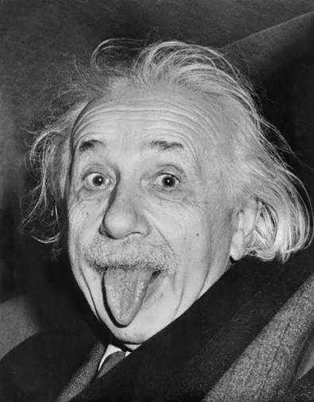

Welcome to my personal website! This is a collection of my work, research, and interests. I hope you find it useful and informative.

::: {.callout-important}
The website is still under construction, thus the current content is more of a draft than a finished product.
:::

The website is organized into 5 main sections:

- [Home](index.qmd): This is the homepage of the website, which provides an overview of my work and interests.

- [CV](cv.qmd): This section contains my curriculum vitae, which provides an overview of my education, work experience, and skills.

- [News](news.qmd): This section contains news and updates about my work and research.

- [Blog](blog.qmd): This section contains my blog posts, where I share my thoughts and ideas on various topics.

- [Knowledge Base](Knowledge%20base/Knowledge%20base.qmd): This section contains my knowledge base, which is a collection of my notes, ideas, and resources on various topics. It is organized by scientific field and research area.

---

---